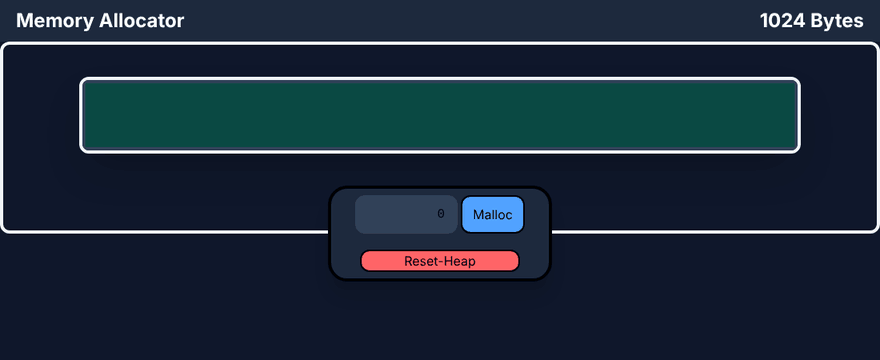

# Heap Visualizer

An interactive visualizer for a **dynamic memory allocator** written in C++ and running directly in the browser through **WebAssembly**. The heap is simulated as a doubly linked list of memory blocks, and the UI (React + Tailwind) draws in real time how memory gets split, allocated and released as you call `malloc`, `realloc` and `free`.

The project is educational: it lets you see **fragmentation** happen, watch free blocks get **split** and **coalesced**, and understand how the **First Fit**, **Next Fit** and **Best Fit** allocation strategies differ.



---

## Contents

- [Features](#features)
- [Architecture](#architecture)
- [Project structure](#project-structure)
- [How the allocator works](#how-the-allocator-works)
- [C++ ↔ JavaScript bridge](#c--javascript-bridge)
- [User interface](#user-interface)
- [Getting started](#getting-started)
- [Makefile targets](#makefile-targets)
- [Current status and roadmap](#current-status-and-roadmap)

---

## Features

- A simulated **1024-byte** heap, drawn as a horizontal bar where each block's width is proportional to its size.
- Blocks are color-coded by state: **green = FREE**, **red = ALLOC**.
- **Malloc** from the control panel (any size from 0 to 1024 bytes).
- Clicking a block opens a panel with its details (status, size) and, for allocated blocks, **Free** and **Realloc** actions.
- **Reset Heap** brings the heap back to a single 1024-byte free block.
- All sizes are **8-byte aligned**, like in a real allocator.
- Three allocation strategies implemented in C++: First Fit, Next Fit and Best Fit.

## Architecture

```
┌──────────────────────────┐        ccall()         ┌──────────────────────────┐
│   React + TypeScript     │ ─────────────────────▶ │   C++ compiled to WASM   │
│   (src/)                 │                        │   (core/ → heap.wasm)    │
│                          │ ◀───────────────────── │                          │
│  renders the blocks      │   JSON list of blocks  │  Manager → Heap → Blocks │
└──────────────────────────┘                        └──────────────────────────┘
```

All allocation logic lives in C++. The frontend does no memory bookkeeping of its own: it sends commands (`malloc`, `free`, `realloc`, `reset`), then asks for the heap's state serialized as JSON and re-renders it.

## Project structure

```
Heap-Visualizer/
├── core/                    # Allocator logic (C++)
│   ├── MemoryBlock.h/.cpp   # A single memory block: size, status, next, prev
│   ├── Heap.h/.cpp          # Base class: the block list and JSON serialization
│   ├── FirstFitHeap.h/.cpp  # First Fit strategy
│   ├── NextFitHeap.h/.cpp   # Next Fit strategy
│   ├── BestFitHeap.h/.cpp   # Best Fit strategy
│   ├── HeapFactory.h/.cpp   # Builds the right heap from a string ("BEST_FIT", etc.)
│   ├── Manager.h/.cpp       # Holds a collection of heaps and serializes them
│   ├── bridge.cpp           # Functions exported to JavaScript (wasm*)
│   └── main.cpp             # Native test program (no browser needed)
│
├── src/                     # Frontend (React 19 + TypeScript + Tailwind 4)
│   ├── App.tsx              # Loads the WASM module, holds state, wires malloc/free/realloc
│   ├── heap.js              # Emscripten-generated glue code (do not edit by hand)
│   ├── main.tsx             # React entry point
│   ├── index.css            # Tailwind import
│   └── Components/
│       ├── Header.tsx             # Top bar with the title and heap size
│       ├── Heap.tsx               # The block bar + the selected-block panel
│       ├── MemoryBlock.tsx        # TS model of a block (id, size, status)
│       ├── MemoryBlockUI.tsx      # Renders one block, width proportional to its size
│       ├── SelectedBlockPanel.tsx # Block details + Free / Realloc
│       ├── ControlPanel.tsx       # Malloc input + Reset Heap
│       └── Contexts.tsx           # React Contexts for malloc/free/realloc/reset
│
├── public/
│   └── heap.wasm            # WebAssembly binary compiled from core/
│
├── Makefile                 # Native build, Valgrind run and WASM build
├── package.json             # Dependencies and Vite scripts
├── vite.config.ts
└── index.html
```

## How the allocator works

### Memory blocks

The heap is a **doubly linked list** of `MemoryBlock` objects. Each block stores:

| Field    | Meaning                         |
|----------|---------------------------------|
| `size`   | size in bytes                   |
| `status` | `FREE` or `ALLOC`               |
| `next`   | the next block in the heap      |
| `prev`   | the previous block in the heap  |

On startup the heap contains a single 1024-byte `FREE` block.

Core block operations:

- **`splitBlock(size)`** — marks the block as `ALLOC` with the requested size and turns the remainder into a new `FREE` block right after it (which is then merged with any free neighbor).
- **`mergeNext()` / `mergePrev()`** — merges the block with its free right / left neighbor (coalescing).
- **`joinNext(n)` / `joinPrev(n)`** — "borrows" `n` bytes from a free neighbor; used by `realloc` to grow a block in place.

### Allocation strategies

Every strategy first rounds the requested size up to a multiple of 8 (`(size + 7) & ~7`).

| Strategy      | How it picks a free block                                                                                   |
|---------------|-------------------------------------------------------------------------------------------------------------|
| **First Fit** | Scans the heap from the start and takes the **first** free block that is large enough.                      |
| **Next Fit**  | Starts scanning from the **last allocated block**; if nothing fits, wraps around to the start of the heap.  |
| **Best Fit**  | Scans the whole heap and takes the **smallest** free block that still fits, minimizing wasted space.        |

### `free`

The block is marked `FREE` and then merged with free neighbors on both sides, so two free blocks are never left next to each other.

### `realloc`

1. If the new size is 0 → behaves like `free`.
2. If the new size is **smaller** → the block shrinks and the remainder becomes free.
3. If it is **larger**, it tries to grow **in place**, in this order:
   - using the free block on the right,
   - using the free block on the left,
   - using both free neighbors.
4. If growing in place is not possible → it `malloc`s elsewhere and frees the old block. If that fails too, the original block is left untouched.

### Manager and HeapFactory

- **`HeapFactory`** takes a string (`"FIRST_FIT"`, `"NEXT_FIT"`, `"BEST_FIT"`) and builds the matching heap.
- **`Manager`** holds a vector of equally sized heaps, can add or remove heaps, and serializes all of them into a single JSON object. It is the foundation for comparing strategies side by side.

### Serialization

Each heap is turned into a JSON array, where `id` is the block's real address in WASM memory:

```json
[
  {"id":"0x11a40","status":"ALLOC","size":64},
  {"id":"0x11a60","status":"FREE","size":960}
]
```

The frontend sends that same `id` back on `free`/`realloc`, so the bridge can locate the exact block.

## C++ ↔ JavaScript bridge

The functions in `core/bridge.cpp` are exported with `EMSCRIPTEN_KEEPALIVE` and called from `App.tsx` via `Module.ccall(...)`:

| WASM function                | What it does                                              |
|------------------------------|-----------------------------------------------------------|
| `wasmCreateManager()`        | Creates the manager (only once)                           |
| `wasmAddHeap(type)`          | Adds a heap of the given type                             |
| `wasmDeleteHeap(index)`      | Removes a heap from the manager                           |
| `wasmGetHeap()`              | Returns the first heap as JSON (creates it if missing)    |
| `wasmGetHeaps()`             | Returns all heaps as JSON                                 |
| `wasmMalloc(size)`           | Allocates `size` bytes                                    |
| `wasmFree(address)`          | Frees the block at the given address (hex string)         |
| `wasmRealloc(address, size)` | Resizes the block                                         |
| `wasmReconstructHeap(json)`  | Rebuilds a heap from saved JSON                           |
| `wasmResetHeap()`            | Destroys the current heap and creates a fresh, empty one  |

The React flow is always the same: **WASM call → `refreshBlocks()` → `wasmGetHeap()` → `JSON.parse` → `setBlocks`**, and the components re-render.

## User interface

- **Header** – the "Memory Allocator" title and the total heap size.
- **Heap** – the main bar; each block takes up `size / 1024 * 100%` of the width.
- **SelectedBlockPanel** – appears under the clicked block; shows its status and size and offers Free / Realloc for allocated blocks.
- **ControlPanel** – a numeric input for Malloc (digits only, capped at 1024) and the Reset-Heap button.

The `malloc`, `free`, `realloc` and `reset` functions reach the components through **React Context**, so they don't have to be passed down manually as props.

## Getting started

### Requirements

- **Node.js** 20+ and npm
- (optional, only if you change the C++ code) **Emscripten SDK** installed in `~/.emsdk`
- (optional) **g++** and **valgrind** for native testing

### Run the frontend

`heap.wasm` and `heap.js` are already committed, so you can start right away:

```bash
git clone https://github.com/alex1bondoc/Heap-Visualizer.git
cd Heap-Visualizer
npm install
npm run dev
```

Then open the address Vite prints (usually `http://localhost:5173`).

### Production build

```bash
npm run build     # TypeScript check + Vite build into dist/
npm run preview   # serve the build locally
```

### Rebuilding after changes in `core/`

```bash
source ~/.emsdk/emsdk_env.sh
make compile-wasm
```

This generates `src/heap.js` and moves `heap.wasm` into `public/`.

## Makefile targets

| Target              | Description                                                                 |
|---------------------|-----------------------------------------------------------------------------|
| `make compile-test` | Compiles the native test program (`core/main`) with `g++`                   |
| `make run-test`     | Runs `core/main` (creates one heap of each type and prints them as JSON)    |
| `make memory-test`  | Runs the test under **Valgrind** and writes the report to `valgrind.log`    |
| `make clean-test`   | Removes the test executable                                                 |
| `make compile-wasm` | Compiles `core/` to WebAssembly with `emcc`                                 |

## Current status and roadmap

This is a work in progress. Worth knowing:

- The UI currently works only with the **first heap** in the manager, which is a **Best Fit** heap. First Fit and Next Fit are implemented and can be tested natively, but there is no selector for them in the UI yet.
- The heap size is fixed at **1024 bytes** (set in both `bridge.cpp` and `App.tsx`).
- `calloc` exists in C++ but is not exposed in the UI.
- Persisting state to `localStorage` is started: it is written under the `blocks` key, but on startup it is read from `cariceps`, so the state is not restored after a refresh yet.

Ideas for next steps:

- a strategy selector (First / Next / Best Fit), or showing all three heaps stacked for comparison;
- a configurable heap size;
- statistics: total free memory, largest free block, fragmentation ratio;
- an operation history with undo;
- a `calloc` button.

---

**Built with:** C++ · Emscripten / WebAssembly · React 19 · TypeScript · Vite 7 · Tailwind CSS 4
