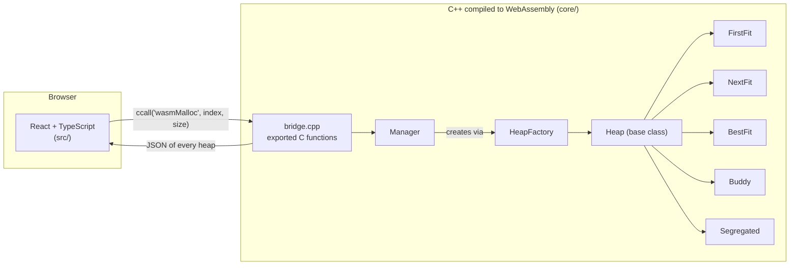

<div align="center">

# 🧠 Heap Visualizer

**Five memory allocators written in C++, compiled to WebAssembly and visualized live in the browser.**

Watch `malloc`, `realloc` and `free` split, coalesce and fragment memory — and compare
First Fit, Next Fit, Best Fit, Buddy and Segregated Lists side by side.

[](https://alex1bondoc.github.io/Heap-Visualizer/)


</div>

---

## ✨ Why this project

Memory allocators are usually invisible: you call `malloc`, you get a pointer. This project opens the box. Every heap is drawn as a bar of blocks, and every operation is executed by a **real allocator implementation in C++** — the browser only renders what the allocator reports.

**What it shows off**

| Area | What's inside |
|---|---|
| **Systems programming** | Five allocation strategies over a hand-managed doubly linked list: block splitting, coalescing, in-place `realloc`, power-of-two buddy trees, size-class zones. |
| **C++ design** | Polymorphic `Heap` hierarchy, `HeapFactory` (factory pattern), a `Manager` that owns many heaps, explicit ownership and cleanup of every block. |
| **C++ ↔ JS interop** | A small C ABI exported from WebAssembly with Emscripten, called from React through `ccall`, with state exchanged as JSON. |
| **Frontend** | React 19 + TypeScript, Context to avoid prop drilling, live re-rendering, form validation, state persisted across refreshes. |
| **Tooling** | Makefile for native, Valgrind and WASM builds; type-checked production build; automatic deploy to GitHub Pages with GitHub Actions. |

---

## 🚀 Features

- 🧩 **Multiple heaps at once** — add as many as you want, each with its own strategy, and compare how they react to the same requests.
- ⚙️ **Five strategies** — First Fit, Next Fit, Best Fit, **Buddy** and **Segregated Lists**.
- 📏 **Configurable heap size** — 64 B to 1 MiB; changing it resets every heap and keeps their types.
- 🗂️ **Configurable segregated heaps** — choose the size classes and how much memory each class gets.
- 🎨 **Live, to-scale view** — block width ∝ block size, 🟩 free / 🟥 allocated, zone boundaries for segregated heaps.
- 🖱️ **Block inspector** — click any block to see it, then **Free** or **Realloc** it.
- 💾 **Persistence** — heaps, contents and settings survive a page refresh.

---

## 🏗️ Architecture



All allocation logic lives in C++; the frontend never keeps its own copy of the heap. Every user action follows the same path:

```
WASM call → wasmGetHeaps() → JSON.parse → setHeaps → re-render → save to localStorage
```

---

## 🧱 How a heap is modelled

A heap is a **doubly linked list of `MemoryBlock`s** covering every byte, in address order:

| Field | Meaning |
|---|---|
| `size` | block size in bytes |
| `status` | `FREE` or `ALLOC` |
| `next`, `prev` | neighbouring blocks |
| `buddy`, `parentBuddy` | used only by the Buddy allocator |

A block's id in the UI is its **real address inside WebAssembly memory** — that's how `free` and `realloc` find the exact block again. No payload is stored; the visualizer tracks *which* bytes are in use.

---

## ⚙️ The allocators

| Strategy | Picks | Free blocks merge with | Strength | Weakness |
|---|---|---|---|---|
| **First Fit** | first free block that fits | any free neighbour | fast, simple | small fragments pile up at the start |
| **Next Fit** | first fit, starting after the last allocation | any free neighbour | spreads allocations out | can fragment the whole heap |
| **Best Fit** | smallest free block that fits | any free neighbour | least wasted space per request | leaves tiny unusable slivers |
| **Buddy** | smallest power-of-two block, split in halves | only its buddy | merging is a pointer lookup, climbs the tree level by level | internal fragmentation (rounds up to 2ⁿ) |
| **Segregated Lists** | a slot in the zone of its size class | only neighbours in the same zone | predictable, no mixing of sizes | a full zone fails even if others are empty |

### First Fit · Next Fit · Best Fit

Requests are rounded up to a multiple of 8 (`(size + 7) & ~7`).

- **`malloc`** finds a free block with the strategy above and **splits** it: the requested part becomes `ALLOC`, the remainder stays `FREE`.
- **`free`** marks the block `FREE` and **coalesces** it with free neighbours on both sides, so two free blocks are never adjacent.
- **`realloc`** shrinks in place, or grows **in place** by borrowing from the free block on the right, the left, or both — and only moves the block when that's impossible. If moving fails too, the original block is left untouched.

### Buddy allocator

Every block is a **power of two** and knows its **buddy** — the other half of the split that created it — **through a pointer**, never by computing addresses.

```
                 split B                                merge L + R
        ┌────────────────────────┐              ┌────────────────────────┐
        │ R.parentBuddy = B.buddy│              │ L.size *= 2            │
        │ R.buddy       = L      │              │ L.buddy = R.parentBuddy│
        │ L.buddy       = R      │              │ delete R               │
        └────────────────────────┘              └────────────────────────┘

   1024 ─ split ─▶ 512 | 512 ─ split ─▶ 256 | 256 | 512 ─ alloc ─▶ [256] | 256 | 512
                   A ↔ B               A ↔ C   (C remembers B)
```

- **`malloc`** rounds up to a power of two (min 16 B), takes the smallest free block that fits and halves it until it's the right size.
- **`free`** merges the block with its buddy while the buddy is free and the same size, climbing back up the tree. `parentBuddy` gives the merged block its own buddy back, so merging can continue level after level.
- **`realloc`** shrinks by splitting; grows in place while the block is the left half and its buddy is completely free.
- **Any heap size works**: a non-power-of-two heap starts as its binary decomposition (`1000 = 512 + 256 + 128 + 64 + 32 + 8`), whose pieces never merge with each other.
- **Reloading** a saved buddy heap replays the same splits, so every buddy pointer is rebuilt exactly.

### Segregated Lists

The heap is split into isolated **zones**, one per **size class**, plus a **large zone** for everything bigger:

```
heap = 1024 B, default classes 16 / 32 / 64
┌──────────┬──────────┬──────────┬──────────────────────────────┐
│  16 B    │  32 B    │  64 B    │            large             │
│  128 B   │  128 B   │  128 B   │            640 B             │
└──────────┴──────────┴──────────┴──────────────────────────────┘
```

- **`malloc`** uses the smallest class that fits and takes one slot **only from that zone**; bigger requests go to the large zone (first fit). A full zone **fails** — zones never borrow from each other.
- **`free`** coalesces only inside the same zone; no block ever crosses a zone boundary.
- **Configurable from the UI** as a `class:zoneSize` list (default `16:128,32:128,64:128`). Classes must be increasing multiples of 8, each zone a multiple of its class, and all zones must fit in the heap — the rest becomes the large zone.

---

## 🔌 C++ ↔ JavaScript bridge

Exported from `core/bridge.cpp` with `EMSCRIPTEN_KEEPALIVE` and called from `src/App.tsx` via `Module.ccall`:

| Function | Purpose |
|---|---|
| `wasmSetHeapSize(size)` | size used for new heaps |
| `wasmAddHeap(type, config)` | add an empty heap (`config` only for segregated) |
| `wasmDeleteHeap(index)` / `wasmClearHeaps()` | erase one / every heap |
| `wasmMalloc(index, size)` | allocate in a heap |
| `wasmFree(index, address)` | free a block |
| `wasmRealloc(index, address, size)` | resize a block |
| `wasmResetHeap(index)` | empty a heap, keeping its type and config |
| `wasmGetHeaps()` | every heap as JSON |
| `wasmReconstructHeap(type, config, json)` | rebuild a heap from a save |

<details>
<summary><b>Example JSON returned by <code>wasmGetHeaps()</code></b></summary>

```json
[
  {"type":"BEST_FIT","config":"","blocks":[
    {"id":"0x11a40","status":"ALLOC","size":64},
    {"id":"0x11a60","status":"FREE","size":960}
  ]},
  {"type":"SEGREGATED","config":"16:128,32:128,64:128","blocks":[
    {"id":"0x11b00","status":"ALLOC","size":16,"zone":"16"},
    {"id":"0x11b20","status":"FREE","size":112,"zone":"16"}
  ]}
]
```

</details>

---

## 🖥️ Frontend

| Component | Role |
|---|---|
| `App.tsx` | loads the WASM module, owns the heaps and heap size, wires every action to the bridge |
| `Header.tsx` | title and the **Heap size** input |
| `HeapCard.tsx` | one heap: title, **Erase Heap**, the bar and its controls |
| `Heap.tsx` | the block bar, zone labels and the block inspector popup |
| `MemoryBlockUI.tsx` | one block, width proportional to its size |
| `SelectedBlockPanel.tsx` | block details + **Free** / **Realloc** |
| `ControlPanel.tsx` | **Malloc** and **Reset Heap** |
| `AddHeapForm.tsx` | strategy picker, segregated class editor with validation, **Add Heap** |
| `Contexts.tsx` | React Contexts for malloc / free / realloc / reset |

Each `HeapCard` provides `free`, `realloc`, `malloc` and `reset` through **React Context**, already bound to its own heap index — so the inspector inside heap #2 acts on heap #2 without passing callbacks through every layer.

State is saved to `localStorage` (`heaps`, `heapSize`) and restored on load; saves that no longer match the current heap size are skipped.

---

## 🏁 Getting started

The compiled `heap.wasm` and `heap.js` are committed, so Node.js is all you need:

```bash
git clone https://github.com/alex1bondoc/Heap-Visualizer.git
cd Heap-Visualizer
npm install
npm run dev        # http://localhost:5173/Heap-Visualizer/
```

| Command | What it does |
|---|---|
| `npm run dev` | development server |
| `npm run build` | type check (`tsc -b`) + production build into `dist/` |
| `npm run preview` | serve the production build |
| `npm run lint` | ESLint |

### Working on the C++ core

Requires the [Emscripten SDK](https://emscripten.org/) in `~/.emsdk`:

```bash
git clone https://github.com/emscripten-core/emsdk.git ~/.emsdk
cd ~/.emsdk && ./emsdk install latest && ./emsdk activate latest
```

| Make target | What it does |
|---|---|
| `make compile-wasm` | builds `core/` with `em++` → `src/heap.js` + `public/heap.wasm` |
| `make compile-test` | builds the native test program `core/main` with `g++` |
| `make run-test` | runs it |
| `make memory-test` | runs it under **Valgrind** → `valgrind.log` |
| `make clean-test` | removes `core/main` |

After changing `core/`, run `make compile-wasm` and commit the regenerated `src/heap.js` and `public/heap.wasm`.

---

## 📦 Deployment

Every push to `main` triggers [`.github/workflows/deploy.yml`](.github/workflows/deploy.yml): `npm ci` → `npm run build` → publish `dist/` to **GitHub Pages**. The WebAssembly module is prebuilt and committed, so CI doesn't need Emscripten.

---

## 📁 Project structure

```
Heap-Visualizer/
├── core/                       # allocators (C++)
│   ├── MemoryBlock.*           # block: size, status, next/prev, buddy pointers
│   ├── Heap.*                  # base class: block list, JSON (de)serialization
│   ├── FirstFitHeap.*  NextFitHeap.*  BestFitHeap.*
│   ├── BuddyHeap.*             # buddy allocator
│   ├── SegregatedHeap.*        # size-class zones, configurable
│   ├── HeapFactory.*           # builds a heap from its type name
│   ├── Manager.*               # owns every heap, serializes them
│   ├── bridge.cpp              # C functions exported to JavaScript
│   └── main.cpp                # native test program
├── src/                        # React + TypeScript frontend
│   ├── App.tsx
│   ├── Components/
│   └── heap.js                 # generated Emscripten glue
├── public/heap.wasm            # generated WebAssembly module
├── .github/workflows/deploy.yml
└── Makefile
```

---

## 🛣️ Roadmap

- Per-heap statistics: free memory, largest free block, fragmentation ratio
- Replay the same sequence of operations on every heap at once
- Operation history with undo
- Highlight a block's buddy on hover
- Expose `calloc` in the UI

---

<div align="center">

Built by **[Alex Bondoc](https://github.com/alex1bondoc)** · C++ · WebAssembly · React · TypeScript

</div>
